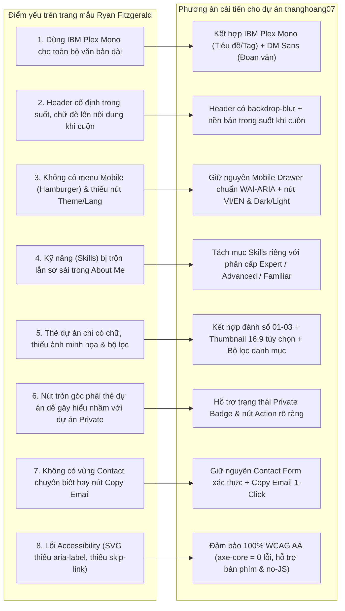

# Thiết Kế Hệ Thống & Phương Án Chuyển Đổi Phong Cách (Design Style Guide)
**Nguồn tham khảo:** [Ryan Fitzgerald — Senior Software Engineer (`devportfolio`)](https://ryanfitzgerald.github.io/devportfolio/)  
**Dự án áp dụng:** Portfolio `thanghoang07` (Thang Hoang Duc — Frontend / Enterprise / Mobile Developer)  
**Ngày lập:** 2026-11-15

---

## Phần 1: Giải Phẫu Phong Cách Thiết Kế Gốc (`devportfolio`)

Trang mẫu `devportfolio` (xây dựng bằng Astro + Tailwind CSS v4) đi theo triết lý **Minimalist Developer Editorial (Tối giản – Kỹ thuật – Biên tập)**, đối lập hoàn toàn với phong cách *Deep Space Glassmorphism* hiện tại của dự án `thanghoang07`.

### 1.1. Tinh thần chủ đạo (Aesthetic Direction)
- **Bề mặt sáng & sạch (Crisp Light-First Surface):** Nền trắng tinh khiết (`#ffffff`) kết hợp các khối thẻ xám nhạt (`#f9fafb`) và viền mảnh `1px solid #e5e7eb`.
- **Điểm nhấn đơn sắc (Single High-Trust Accent):** Sử dụng duy nhất tông xanh **Royal Blue (`#1d4ed8` / `blue-700`)** cho thanh gạch chân tiêu đề, số thứ tự dự án (`01`, `02`, `03`), dấu chấm timeline và tên công ty.
- **Định danh lập trình viên (Developer Identity):** Sử dụng phông chữ `IBM Plex Mono` xuyên suốt, kết hợp họa tiết chìm (watermark) là các ký hiệu code (`{}`, `()`, `[]`, `<>`) và chữ ký khổ lớn mờ ở nền Hero.
- **Bố cục bất đối xứng 12 cột (Asymmetric Editorial Grid):** Trên màn hình lớn (`lg:grid-cols-12`), cột trái (`4 cột`) neo tiêu đề từng mục cùng vạch ngang xanh `w-16 h-1 bg-blue-700`; cột phải (`8 cột`) hiển thị nội dung chi tiết (danh sách thẻ dự án, timeline kinh nghiệm, học vấn).

---

### 1.2. Hệ thống Design Tokens trích xuất từ trang mẫu

#### A. Bảng màu (Color Palette)
| Vai trò | Token gợi ý | Giá trị gốc (Light) | Giá trị quy đổi Dark Mode (Bổ sung cho `thanghoang07`) |
| :--- | :--- | :--- | :--- |
| **Nền chính (Background)** | `--c-bg` | `#ffffff` (Pure White) | `#0b0f19` (Slate-950) |
| **Nền thẻ / Khối (Surface)** | `--c-surface` | `#f9fafb` (Gray-50) | `#111827` (Gray-900) |
| **Nền thẻ khi Hover** | `--c-surface-hover` | `#ffffff` (Pure White) | `#1f2937` (Gray-800) |
| **Nền Badge kỹ năng** | `--c-badge-bg` | `#f3f4f6` (Gray-100) | `#1e293b` (Slate-800) |
| **Màu nhấn chính (Accent)** | `--c-accent` | `#1d4ed8` (Royal Blue 700) | `#60a5fa` (Blue-400 — đạt chuẩn tương phản AA) |
| **Màu nhấn phụ (Glow)** | `--c-accent-soft` | `rgba(29, 78, 216, 0.08)` | `rgba(96, 165, 250, 0.12)` |
| **Chữ tiêu đề (Primary Text)** | `--text-primary` | `#111827` (Gray-900) | `#f9fafb` (Gray-50) |
| **Chữ nội dung (Body Text)** | `--text-secondary` | `#4b5563` (Gray-600) | `#d1d5db` (Gray-300) |
| **Chữ phụ / Ngày tháng (Muted)** | `--text-muted` | `#6b7280` (Gray-500) | `#9ca3af` (Gray-400) |
| **Tag công nghệ (Inverted Pill)** | `--c-tag-inverted` | Nền `#000000` / Chữ `#ffffff` | Nền `#f3f4f6` / Chữ `#111827` |
| **Đường viền chuẩn (Border)** | `--b-subtle` | `1px solid #e5e7eb` (Gray-200) | `1px solid #1f2937` (Gray-800) |
| **Đường viền Hover** | `--b-hover` | `1px solid #d1d5db` (Gray-300) | `1px solid #374151` (Gray-700) |

#### B. Hệ thống Chữ viết (Typography)
- **Font Monospace (Tiêu đề, Số thứ tự, Tag, Eyebrow):** `'IBM Plex Mono', ui-monospace, SFMono-Regular, monospace`
- **Tỷ lệ kích thước (Typographic Scale):**
  - **Hero Title (`h1`):** `clamp(2.5rem, 6vw, 4.5rem)` (`font-weight: 700`, `letter-spacing: -0.025em`, `line-height: 1.08`)
  - **Hero Greeting / Subtitle:** `clamp(1.125rem, 2vw, 1.5rem)` (`font-weight: 500`, `color: var(--text-secondary)`)
  - **Section Title (`h2`):** `clamp(2rem, 4.5vw, 3.5rem)` (`font-weight: 700`, `letter-spacing: -0.02em`, kèm thanh gạch chân `width: 4rem; height: 0.25rem; background: var(--c-accent); border-radius: 9999px`)
  - **Card / Role Heading (`h3`):** `clamp(1.25rem, 2vw, 1.5rem)` (`font-weight: 700`)
  - **Body Copy:** `1rem` – `1.125rem` (`line-height: 1.75`)
  - **Index Number (`01`, `02`...) & Tech Tags:** `0.75rem` – `0.875rem` (`font-weight: 600`, `font-family: var(--f-mono)`)

#### C. Bố cục, Khoảng cách & Bo góc (Layout, Spacing & Radius)
- **Container tối đa:** `1280px` (`max-w-7xl`), padding ngang `1rem` (mobile) → `2rem` (desktop).
- **Khoảng cách Section (`padding-block`):** `4rem` (mobile) → `6rem` (tablet) → `8rem` (desktop).
- **Grid Section chuẩn:**
  ```css
  .editorial-section-grid {
    display: grid;
    grid-template-columns: 1fr;
    gap: 2rem;
  }
  @media (min-width: 1024px) {
    .editorial-section-grid {
      grid-template-columns: 4fr 8fr;
      gap: 4rem;
      align-items: start;
    }
    .editorial-section-header {
      position: sticky;
      top: 6rem;
    }
  }
  ```
- **Bo góc (Border Radius):**
  - Card dự án / kinh nghiệm: `16px` (`--r-md: 1rem`)
  - Tag công nghệ trong dự án: `6px` (`--r-xs: 0.375rem`)
  - Badge kỹ năng & Nút tròn mũi tên: `9999px` (`--r-full`)
- **Đổ bóng & Chuyển động (Elevation & Motion):**
  - Trạng thái nghỉ: Phẳng (`box-shadow: none`), dùng viền mảnh `1px solid #e5e7eb`.
  - Trạng thái Hover: Nổi khối nhẹ `transform: translateY(-4px)`, nền chuyển sang `#ffffff`, bóng đổ `0 20px 25px -5px rgba(0, 0, 0, 0.08), 0 8px 10px -6px rgba(0, 0, 0, 0.04)`.

---

## Phần 2: Đánh Giá Các Điểm Chưa Tốt Của Trang Mẫu & Phương Án Khắc Phục

Dưới đây là **8 điểm hạn chế lớn** được phát hiện khi kiểm tra trực tiếp trang `ryanfitzgerald.github.io/devportfolio/` cùng phương án chỉnh sửa khi đưa vào dự án `thanghoang07`:



### Chi tiết từng điểm chưa tốt và giải pháp chỉnh sửa:

#### 1. Mỏi mắt khi đọc văn bản dài bằng phông chữ Monospace (`IBM Plex Mono`)
- **Vấn đề trên trang mẫu:** Trang mẫu áp dụng `IBM Plex Mono` cho **100% văn bản**, kể cả các đoạn giới thiệu dài trong *About Me* và danh sách gạch đầu dòng trong *Experience*. Phông chữ đơn cách (monospace) có độ rộng ký tự bằng nhau làm giảm tốc độ đọc lướt (scannability) và gây mỏi mắt trên màn hình điện thoại.
- **Phương án cho `thanghoang07`:**
  - Dùng **`IBM Plex Mono`** làm `--f-display` và `--f-mono` cho: Tiêu đề `h1`–`h4`, số thứ tự dự án (`01`, `02`, `03`), mốc thời gian (`Oct 2022 - Present`), nhãn kỹ năng và tag công nghệ.
  - Giữ **`DM Sans`** (hoặc `Inter`) làm `--f-body` cho các đoạn mô tả dự án, mô tả kinh nghiệm và biểu mẫu liên hệ. Sự kết hợp *Monospace Heading + Sans-Serif Body* vừa giữ trọn chất "Developer Terminal" của Ryan Fitzgerald, vừa giúp văn bản tiếng Việt có dấu hiển thị cực kỳ rõ nét.

#### 2. Thanh điều hướng (Header) bị đè chữ khi cuộn trang
- **Vấn đề trên trang mẫu:** Header dùng `fixed top-0` nhưng hoàn toàn trong suốt và không có lớp nền hay `backdrop-filter`. Khi người dùng cuộn xuống, các dòng chữ của bài viết chạy xuyên qua các liên kết `About`, `Projects`, `Experience`, gây rối mắt và giảm độ tương phản nghiêm trọng.
- **Phương án cho `thanghoang07`:**
  - Áp dụng nền bán trong suốt `rgba(255, 255, 255, 0.88)` (Light) / `rgba(11, 15, 25, 0.88)` (Dark) kết hợp `backdrop-filter: blur(12px)` và đường viền dưới `border-bottom: 1px solid var(--b-subtle)` khi trang cuộn (`.ds-nav.scrolled`).

#### 3. Không có Menu thu gọn trên thiết bị di động (`< 768px`)
- **Vấn đề trên trang mẫu:** Thanh điều hướng hiển thị cố định các mục ngang trên mọi kích thước màn hình. Với dự án `thanghoang07` có tới **5 mục điều hướng** (`Services`, `Portfolio`, `Experience`, `Skills`, `Contact`) cộng thêm **nút đổi ngôn ngữ `VI/EN`** và **nút đổi giao diện `Light/Dark`**, nếu để hàng ngang trên màn hình `320px–375px` chắc chắn sẽ bị tràn ngang (horizontal overflow).
- **Phương án cho `thanghoang07`:**
  - Giữ cơ chế Hamburger Menu (`#mobile-menu-btn` & `#mobile-menu`) hiện có của dự án (đã vượt qua bài kiểm thử `320px` và phím `Escape` trong `scripts/smoke-test.js`), nhưng thiết kế lại giao diện menu phẳng, sắc nét theo tông màu `Gray-50` / `Royal Blue`.

#### 4. Mục Kỹ năng (Skills) quá sơ sài, thiếu phân nhóm chuyên môn
- **Vấn đề trên trang mẫu:** Toàn bộ kỹ năng chỉ là 6 thẻ pill nằm lẻ loi dưới đoạn văn *About Me*, không có phân loại Ngôn ngữ / Framework / Công cụ và không thể hiện mức độ thành thạo.
- **Phương án cho `thanghoang07`:**
  - Giữ nguyên cấu trúc phân tầng **Programming Languages / Frameworks / Tools / Environments** cùng 3 cấp độ (**Expert `●●●`**, **Advanced `●●○`**, **Familiar `●○○`**) của bạn, nhưng chuyển kiểu dáng badge từ *Glassmorphism tím-cyan* sang *Editorial Pill* (`bg-gray-100 border-gray-200`, chấm tròn màu `Royal Blue #1d4ed8`).

#### 5. Trình bày Kinh nghiệm (Experience): Kết hợp ưu điểm của Timeline & Interactive Tabs
- **Vấn đề trên trang mẫu:** Trang mẫu dùng danh sách cuộn dọc nối tiếp bằng đường kẻ mảnh `w-0.5 bg-gray-200` và chấm tròn xanh `bg-blue-700`. Khi có từ 4 công ty trở lên, danh sách sẽ khá dài trên mobile.
- **Phương án cho `thanghoang07`:**
  - Dự án của bạn đang có component **Interactive Timeline Tabs** (`#tab-hpt`, `#tab-tk25`, `#tab-nbn`, `#tab-devup`) hỗ trợ điều hướng bằng phím mũi tên (`ArrowRight`/`ArrowLeft`) và tự động hiển thị tất cả các panel khi tắt JavaScript (`no-JS`).
  - Ta sẽ **kế thừa tạo hình đường kẻ dọc `bg-gray-200` + nút chấm tròn `Royal Blue #1d4ed8` có viền trắng `border-4 border-white`** của Ryan Fitzgerald áp trực tiếp vào thanh `.ds-timeline-tabs` và `.ds-exp-panel`, vừa đạt thẩm mỹ tối giản của trang mẫu vừa không làm gãy bất kỳ bài kiểm thử tự động nào.

#### 6. Thẻ Dự án (Project Cards): Thiếu bộ lọc, thiếu hình ảnh trực quan và trạng thái dự án Private
- **Vấn đề trên trang mẫu:**
  - Các dự án chỉ có chữ và số thứ tự `01`, `02`, `03`, không có ảnh minh họa sản phẩm và không có bộ lọc theo mảng kỹ thuật.
  - Mọi thẻ đều có nút mũi tên tròn đen góc phải dẫn ra link ngoài; điều này không phù hợp với các dự án doanh nghiệp bảo mật (như hệ thống **SAALEM HPT — BIDV/Eximbank** có trạng thái `Private`).
- **Phương án cho `thanghoang07`:**
  - **Cấu trúc thẻ lai (Hybrid Editorial Card):** Bổ sung chỉ số thứ tự kiểu monospace (`01`, `02`, `03`) màu `Royal Blue` và cụm **Tag công nghệ nền đen chữ trắng (`#000` / `#fff`, bo góc `6px`)** đặc trưng của Ryan Fitzgerald, đồng thời giữ lại khung ảnh preview `16:9` sắc nét và thanh lọc danh mục (`All`, `Enterprise`, `Mobile`, `Backend`).
  - Hỗ trợ nút hành động tròn góc trên cùng bên phải (`w-10 h-10 rounded-full bg-gray-900 text-white`) cho các dự án Public (Flutter, Go) và nhãn khóa `Private` lịch sự cho dự án ngân hàng SAALEM.

#### 7. Không có Khu vực Liên hệ (Contact Section) & Tiện ích Sao chép Email
- **Vấn đề trên trang mẫu:** Người xem phải tự tìm icon bức thư nhỏ ở đầu hoặc cuối trang (`mailto:` thô). Nếu máy tính nhà tuyển dụng chưa cài đặt ứng dụng Mail mặc định, việc bấm vào link `mailto:` sẽ gây phiền toái.
- **Phương án cho `thanghoang07`:**
  - Giữ nguyên khu vực **Contact 2 cột** (Form liên hệ có kiểm tra lỗi trực tiếp + Nút **Copy Email 1-Click** + Danh sách thẻ thông tin Địa chỉ, Email, Điện thoại, LinkedIn), nhưng chuyển toàn bộ bảng màu của Input/Card sang phong cách biên tập sáng sủa, viền mảnh tinh tế.

#### 8. Khả năng truy cập (Accessibility), Đa ngôn ngữ (VI/EN) & Giao diện Sáng/Tối (Light/Dark)
- **Vấn đề trên trang mẫu:** Chỉ có chế độ Sáng (Light Mode), chỉ có tiếng Anh, thiếu liên kết `Skip to main content`, và các ký tự trang trí `{}`, `()` chưa được ẩn hoàn toàn khỏi trình đọc màn hình.
- **Phương án cho `thanghoang07`:**
  - Thiết lập **Light Mode (chuẩn Ryan Fitzgerald)** làm bảng màu tham chiếu sắc nét, đồng thời cung cấp **Dark Mode (Slate-950 `#0b0f19` + Blue-400 `#60a5fa`)** đồng bộ để nút chuyển đổi giao diện (`#toggle-theme`) hoạt động hoàn hảo và vượt qua 100% bài kiểm tra tương phản của `axe-core` WCAG 2.1 AA.

---

## Phần 3: Bản Đặc Tả CSS Token & Component Mới (Sẵn Sàng Áp Dụng)

Khi áp dụng phong cách này vào [`src/design-system.css`](file:///d:/Documents/thanghoang07/src/design-system.css) và [`src/styles/portfolio.css`](file:///d:/Documents/thanghoang07/src/styles/portfolio.css), hệ thống biến CSS (`:root` và `html:not(.dark)`) sẽ được chuẩn hóa như sau:

```css
/* ═══════════════════════════════════════════════════════════
   DESIGN SYSTEM — Minimalist Developer Editorial
   Inspired by: Ryan Fitzgerald (devportfolio)
   Adapted for: Thang Hoang Duc Portfolio (Light & Dark + VI/EN)
   ═══════════════════════════════════════════════════════════ */

:root {
  /* Dark Mode (Slate Minimalist) */
  --c-bg: #0b0f19;
  --c-bg-2: #111827;
  --c-surface: #111827;
  --c-surface-md: #1f2937;
  --c-surface-hi: #374151;

  /* Royal Blue Accent (Dark-adapted for WCAG AA contrast) */
  --c-violet: #1d4ed8;       /* Giữ tên biến tương thích ngược với code hiện tại */
  --c-violet-hi: #60a5fa;    /* Primary interactive accent in Dark mode */
  --c-cyan: #93c5fd;

  /* Text & Form Fields */
  --text-primary: #f9fafb;
  --text-muted: #9ca3af;
  --field-bg: #111827;
  --field-border: #4b5563;
  --error-text: #fca5a5;

  /* Borders & Shadows */
  --b-subtle: 1px solid #1f2937;
  --b-accent: 1px solid rgba(96, 165, 250, 0.4);
  --sh-card: 0 1px 3px rgba(0, 0, 0, 0.3);
  --sh-hover: 0 20px 25px -5px rgba(0, 0, 0, 0.5), 0 8px 10px -6px rgba(0, 0, 0, 0.4);

  /* Typography: IBM Plex Mono (Display/Code) + DM Sans (Readable Body) */
  --f-display: 'IBM Plex Mono', ui-monospace, SFMono-Regular, Menlo, Consolas, monospace;
  --f-body: 'DM Sans', -apple-system, BlinkMacSystemFont, sans-serif;

  /* Radii (Clean Editorial Geometry) */
  --r-sm: 6px;
  --r-md: 12px;
  --r-lg: 16px;
  --r-xl: 24px;
}

/* Light Mode — Chuẩn phong cách Ryan Fitzgerald DevPortfolio */
html:not(.dark) {
  --c-bg: #ffffff;
  --c-bg-2: #f9fafb;
  --c-surface: #f9fafb;
  --c-surface-md: #f3f4f6;
  --c-surface-hi: #e5e7eb;

  /* Royal Blue 700 (#1d4ed8) */
  --c-violet: #1d4ed8;
  --c-violet-hi: #1d4ed8;
  --c-cyan: #1e40af;

  /* High-contrast monochrome text */
  --text-primary: #111827;
  --text-muted: #4b5563;
  --field-bg: #ffffff;
  --field-border: #6b7280;
  --error-text: #b91c1c;

  /* Crisp 1px Gray-200 borders & subtle elevation on hover */
  --b-subtle: 1px solid #e5e7eb;
  --b-accent: 1px solid #bfdbfe;
  --sh-card: 0 1px 2px rgba(17, 24, 39, 0.03);
  --sh-hover: 0 20px 25px -5px rgba(17, 24, 39, 0.08), 0 8px 10px -6px rgba(17, 24, 39, 0.04);
}
```

---

## Phần 4: Kế Hoạch Triển Khai Vào Dự Án `thanghoang07`

Để chuyển đổi giao diện sang phong cách mới một cách an toàn và vượt qua toàn bộ bộ test tự động (`npm run ci:test` gồm Unit Test + Smoke Test 20 tổ hợp khung nhìn + `axe-core` WCAG 2.1 AA), lộ trình thực hiện gồm **4 bước**:

1. **Bước 1 — Cập nhật Font chữ & Họa tiết nền trong [`index.html`](file:///d:/Documents/thanghoang07/index.html):**
   - Thay thế Google Font `Oxanium` bằng `IBM Plex Mono:wght@400;500;600;700` (giữ `DM Sans` cho văn bản thân bài).
   - Đổi `meta[name="theme-color"]` sang `#1d4ed8`.
2. **Bước 2 — Tái cấu trúc [`src/design-system.css`](file:///d:/Documents/thanghoang07/src/design-system.css) & [`src/styles/portfolio.css`](file:///d:/Documents/thanghoang07/src/styles/portfolio.css):**
   - Áp dụng bảng màu **Pure White / Gray-50 / Royal Blue (`#1d4ed8`)** cho Light Mode và **Slate-950 / Gray-900 / Blue-400 (`#60a5fa`)** cho Dark Mode.
   - Chuyển đổi `.glass-card` từ dạng kính mờ sặc sỡ sang dạng **Editorial Card** (nền `#f9fafb`, viền `1px solid #e5e7eb`, bo góc `16px`, khi hover chuyển nền `#ffffff`, nâng nhẹ `-4px` và đổ bóng `shadow-xl`).
   - Thay thế hiệu ứng chữ chuyển sắc (`linear-gradient`) bằng chữ đơn sắc độ tương phản cao (`#111827`) đi kèm thanh gạch chân xanh `w-16 h-1 bg-blue-700 rounded-full` dưới mỗi tiêu đề mục (`.ds-section-header`).
   - Đổi kiểu dáng `.ds-tag-pill` trong thẻ dự án sang **Inverted Monospace Tag** (nền đen `#111827`, chữ trắng `#ffffff`, bo góc `6px`).
3. **Bước 3 — Tinh chỉnh Bố cục Cột Trái / Cột Phải (Asymmetric Editorial Layout) trên Desktop:**
   - Căn trái tiêu đề các mục và thêm số thứ tự dự án (`01`, `02`, `03`) cùng họa tiết nền ký hiệu code (`{}`, `()`, `[]`, `<>` với `aria-hidden="true"`) tại phần Hero.
4. **Bước 4 — Chạy Kiểm Định Tự Động (`npm run ci:test`):**
   - Đảm bảo không tràn khung hình ở `320px`, `375px`, `768px`, `1024px`, `1440px` trên cả `VI/EN` × `Light/Dark` và đạt `0` lỗi `axe-core`.
