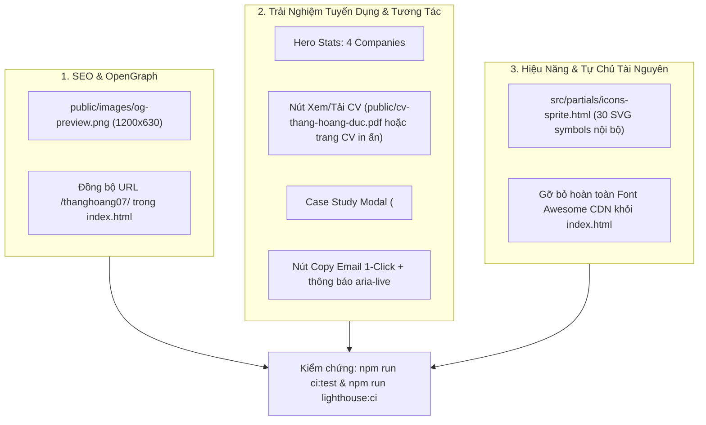

# Kế Hoạch Nâng Cấp Portfolio Giai Đoạn 2 (V3 — 2026-10-19)

Tài liệu này mô tả chi tiết lộ trình thực thi **6 hạng mục nâng cấp tiếp theo** cho dự án Portfolio `thanghoang07`, tập trung vào:
1. **SEO & Chia sẻ mạng xã hội (OpenGraph PNG & Canonical URL)**
2. **Đồng bộ dữ liệu thống kê Hero (`4 Companies`)**
3. **Bổ sung tính năng Xem / Tải CV (Resume PDF / Print-ready View)**
4. **Modal "Case Study & Kiến trúc" cho các dự án Portfolio (bao gồm dự án Private)**
5. **Nâng cấp trải nghiệm Liên hệ (1-Click Copy Email + Toast trạng thái)**
6. **Thay thế hoàn toàn Font Awesome CDN bằng hệ thống Inline SVG Sprite nội bộ**

---

## Kiến Trúc Tổng Quan Của Đợt Nâng Cấp

---

## Chi Tiết Kế Hoạch Chỉnh Sửa Từng Hạng Mục

### Hạng mục 1: Đồng bộ Canonical URL & Tạo ảnh OpenGraph `.png` chuẩn mạng xã hội
- **Vấn đề hiện tại**:
  - Trong [`index.html`](file:///d:/Documents/thanghoang07/index.html#L20-L36), các thẻ `og:url`, `og:image`, `twitter:url`, `twitter:image` và `link[rel="canonical"]` đang trỏ tới `https://thanghoang07.github.io/images/og-preview.svg`.
  - Khi triển khai GitHub Pages dưới đường dẫn `/thanghoang07/` (theo cấu hình `base: '/thanghoang07/'` trong [`vite.config.js`](file:///d:/Documents/thanghoang07/vite.config.js#L6)), đường dẫn đúng phải bao gồm `/thanghoang07/`.
  - Ngoài ra, các trình thu thập dữ liệu (crawler) của **LinkedIn, Facebook, Zalo, Discord** không hỗ trợ render định dạng `.svg` cho `og:image` mà yêu cầu ảnh raster (`.png` / `.jpg`, kích thước chuẩn `1200×630`).
- **Giải pháp thực thi**:
  1. Tạo script hoặc dùng Puppeteer/Canvas xuất trực tiếp file [`public/images/og-preview.svg`](file:///d:/Documents/thanghoang07/public/images/og-preview.svg) thành [`public/images/og-preview.png`](file:///d:/Documents/thanghoang07/public/images/og-preview.png) (`1200×630px`, tối ưu dung lượng `< 60KB`).
  2. Cập nhật các thẻ meta trong [`index.html`](file:///d:/Documents/thanghoang07/index.html#L18-L36):
     - `og:url`, `twitter:url`, `canonical` → `https://thanghoang07.github.io/thanghoang07/`
     - `og:image`, `twitter:image` → `https://thanghoang07.github.io/thanghoang07/images/og-preview.png` (kèm `og:image:width="1200"` và `og:image:height="630"`).

---

### Hạng mục 2: Đồng bộ số liệu thống kê trên Hero (`4 Companies`)
- **Vấn đề hiện tại**:
  - Trong [`src/partials/hero.html`](file:///d:/Documents/thanghoang07/src/partials/hero.html#L31-L34), ô thống kê số công ty đang đặt `3`, trong khi mục **Work Experience** ([`src/partials/experience.html`](file:///d:/Documents/thanghoang07/src/partials/experience.html#L14-L31)) có **4 công ty** (`HPT Vietnam`, `TK25 Tech`, `NBN Media`, `DevUp`).
- **Giải pháp thực thi**:
  1. Cập nhật [`src/partials/hero.html`](file:///d:/Documents/thanghoang07/src/partials/hero.html#L32) thành `data-count="4">4`.
  2. Kiểm tra lại bộ đếm tự động trong [`src/design-system-enhancements.js`](file:///d:/Documents/thanghoang07/src/design-system-enhancements.js) để hiệu ứng count-up chạy mượt tới `4`.

---

### Hạng mục 3: Bổ sung nút "Xem / Tải CV (Resume)" trên Hero
- **Vấn đề hiện tại**:
  - Nhà tuyển dụng truy cập trang chưa có nút tải nhanh hồ sơ năng lực (CV/Resume) dạng bản in hoặc PDF.
- **Giải pháp thực thi**:
  1. Tạo một trang/tệp CV chuẩn in ấn [`public/cv-thang-hoang-duc.html`](file:///d:/Documents/thanghoang07/public/cv-thang-hoang-duc.html) (và xuất sẵn bản PDF tĩnh [`public/Thang-Hoang-Duc-CV.pdf`](file:///d:/Documents/thanghoang07/public/Thang-Hoang-Duc-CV.pdf) bằng Puppeteer từ chính dữ liệu trên portfolio: Thông tin liên hệ, Tóm tắt 5+ năm kinh nghiệm, 4 công ty, Dự án tiêu biểu, Kỹ năng & Chứng chỉ).
  2. Bổ sung nút phụ `Download CV` / `Tải CV (PDF)` trong cụm `.hero-actions` tại [`src/partials/hero.html`](file:///d:/Documents/thanghoang07/src/partials/hero.html#L38-L45) với thuộc tính `href="/Thang-Hoang-Duc-CV.pdf"` (Vite tự động resolve theo `base`) và `target="_blank" rel="noopener"`.
  3. Thêm khóa dịch song ngữ `download-cv` (`"Download CV"` / `"Tải CV (PDF)"`) vào [`src/translations.json`](file:///d:/Documents/thanghoang07/src/translations.json).

---

### Hạng mục 4: Modal "Case Study & Chi Tiết Kiến Trúc" cho 3 dự án Portfolio
- **Vấn đề hiện tại**:
  - Dự án **SAALEM HPT** trong [`src/partials/portfolio.html`](file:///d:/Documents/thanghoang07/src/partials/portfolio.html#L39-L41) chỉ có nhãn tĩnh `Private`, khiến nhà tuyển dụng không xem được độ phức tạp kỹ thuật của hệ thống LOS ngân hàng.
  - Hai dự án **Flutter** và **Go Backend** chưa có phần mô tả sâu về kiến trúc và giải pháp kỹ thuật.
- **Giải pháp thực thi**:
  1. Thiết kế component **Project Case Study Modal** sử dụng thẻ ngữ nghĩa `<dialog id="project-modal" class="ds-modal glass-card">` đặt cuối [`src/partials/portfolio.html`](file:///d:/Documents/thanghoang07/src/partials/portfolio.html):
     - Hỗ trợ đóng bằng phím `Escape`, nút `×`, hoặc click ra vùng backdrop.
     - Trả lại focus (`returnFocus`) về đúng nút vừa bấm sau khi đóng (đạt chuẩn WAI-ARIA Dialog pattern).
  2. Tạo module [`src/ui/project-modal.js`](file:///d:/Documents/thanghoang07/src/ui/project-modal.js) và dữ liệu chi tiết song ngữ VI/EN trong [`src/translations.json`](file:///d:/Documents/thanghoang07/src/translations.json) cho 3 dự án:
     - **SAALEM HPT (Enterprise LOS)**: Bài toán nghiệp vụ ngân hàng BIDV/Eximbank, kiến trúc IBM BPM + Java + JS, quy trình Agile Scrum, tối ưu hóa form nghiệp vụ phức tạp.
     - **Personal Mobile App (Flutter)**: Kiến trúc đa nền tảng iOS/Android, tối ưu UI 60fps, quản lý state và tích hợp REST API.
     - **Go Backend Application**: Thiết kế RESTful API hiệu năng cao với Go, kết nối PostgreSQL, đóng gói container với Docker.
  3. Cập nhật khu vực `.ds-project-card__actions` của cả 3 thẻ dự án trong [`src/partials/portfolio.html`](file:///d:/Documents/thanghoang07/src/partials/portfolio.html) để có nút **"Xem chi tiết / Case Study"** (`data-project-modal="saalem|flutter|go"`).
  4. Viết thêm unit test trong [`tests/unit/page-interactions.test.js`](file:///d:/Documents/thanghoang07/tests/unit/page-interactions.test.js) kiểm tra mở/đóng modal và chuyển đổi ngôn ngữ.

---

### Hạng mục 5: Nâng cấp phần Liên hệ với nút "Sao chép Email 1-Click" & Phản hồi trực quan
- **Vấn đề hiện tại**:
  - Nhiều người dùng máy tính không cài đặt ứng dụng mail mặc định cho giao thức `mailto:`, dẫn đến việc bấm `Open email app` không thuận tiện bằng việc copy nhanh địa chỉ email.
- **Giải pháp thực thi**:
  1. Trong [`src/partials/contact.html`](file:///d:/Documents/thanghoang07/src/partials/contact.html#L30-L34), nâng cấp khu vực nút hành động và dòng fallback:
     - Thêm nút phụ **`Copy email`** (`id="contact-copy-email"`, `data-email="thanghoang07@gmail.com"`) ngay cạnh nút `Open email app` hoặc tại thẻ Email trong `.ds-contact-list`.
     - Khi bấm, tự động chép `thanghoang07@gmail.com` vào clipboard (`navigator.clipboard.writeText`), đổi nhãn nút tạm thời sang `"Đã sao chép email!"` / `"Email copied!"` trong 2.5 giây và phát thông báo vào vùng `#contact-status` (`aria-live="polite"`).
  2. Cập nhật logic trong [`src/contact-form.js`](file:///d:/Documents/thanghoang07/src/contact-form.js) và bổ sung unit test cho hành vi copy email.

---

### Hạng mục 6: Thay thế Font Awesome CDN bằng hệ thống Inline SVG Icon nội bộ
- **Vấn đề hiện tại**:
  - [`index.html`](file:///d:/Documents/thanghoang07/index.html#L52-L58) đang tải `font-awesome/6.5.0/css/all.min.css` (~100KB CSS + các file font `.woff2` nặng ~150KB từ `cdnjs.cloudflare.com`) chỉ để hiển thị **26 icon tĩnh**.
  - Việc tải font từ bên thứ 3 làm chậm chỉ số **LCP / FCP** trên mạng di động 4G và tiềm ẩn rủi ro hiển thị ô vuông nếu CDN bị chặn.
- **Giải pháp thực thi**:
  1. Tạo partial [`src/partials/icons-sprite.html`](file:///d:/Documents/thanghoang07/src/partials/icons-sprite.html) chứa `<svg hidden aria-hidden="true"><defs>...</defs></svg>` định nghĩa toàn bộ 26 vector icon đang dùng (`icon-moon`, `icon-sun`, `icon-bars`, `icon-arrow-up`, `icon-arrow-right`, `icon-paper-plane`, `icon-linkedin`, `icon-github`, `icon-code`, `icon-mobile`, `icon-microchip`, `icon-cogs`, `icon-lock`, `icon-building`, `icon-calendar`, `icon-map-marker`, `icon-certificate`, `icon-award`, `icon-envelope`, `icon-phone`, `icon-download`, `icon-copy`, `icon-check`, `icon-eye`, `icon-close`, và các icon nhóm kỹ năng).
  2. Thêm class `.ds-icon` (`width: 1em; height: 1em; fill: currentColor; vertical-align: -0.125em; flex-shrink: 0;`) vào [`src/design-system.css`](file:///d:/Documents/thanghoang07/src/design-system.css).
  3. Thay thế các thẻ `<i class="fas/fab ...">` trong [`index.html`](file:///d:/Documents/thanghoang07/index.html) và [`src/partials/*.html`](file:///d:/Documents/thanghoang07/src/partials/header.html) bằng `<svg class="ds-icon" aria-hidden="true"><use href="#icon-..."/></svg>`.
  4. Xóa bỏ hoàn toàn thẻ `<link>` tải Font Awesome CDN trong [`index.html`](file:///d:/Documents/thanghoang07/index.html#L51-L58) và cập nhật [`scripts/status-check.js`](file:///d:/Documents/thanghoang07/scripts/status-check.js) nếu có kiểm tra chuỗi liên quan.

---

## Quy Trình Kiểm Thử & Nghiệm Thu (Verification Gates)

Sau khi hoàn tất cả 6 hạng mục, hệ thống phải vượt qua toàn bộ các cổng kiểm định tự động:
1. **Unit Tests (`npm run test:unit`)**: Toàn bộ các bài kiểm thử hiện có + bài kiểm thử mới cho **Project Case Study Modal** và **Copy Email** đạt `100% PASS`.
2. **Smoke & Accessibility Tests (`npm run test:build`)**:
   - Kiểm tra trên 20 tổ hợp (`320px`, `375px`, `768px`, `1024px`, `1440px` × `Light/Dark` × `VI/EN`) không tràn khung hình (`scrollWidth <= innerWidth + 1`).
   - Kiểm tra `axe-core` WCAG 2.1 AA đạt **0 vi phạm** (bao gồm cả khi mở `<dialog id="project-modal">`).
3. **Lighthouse CI (`npm run lighthouse:ci`)**:
   - Điểm **Accessibility = 100**, **Best Practices = 100**, **SEO = 100**.
   - Điểm **Performance** tăng nhờ loại bỏ hoàn toàn request tới `cdnjs.cloudflare.com`.
